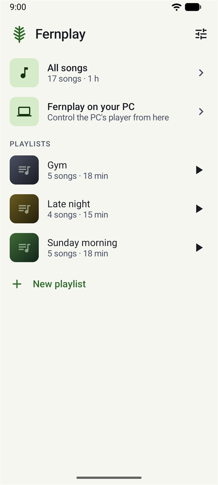
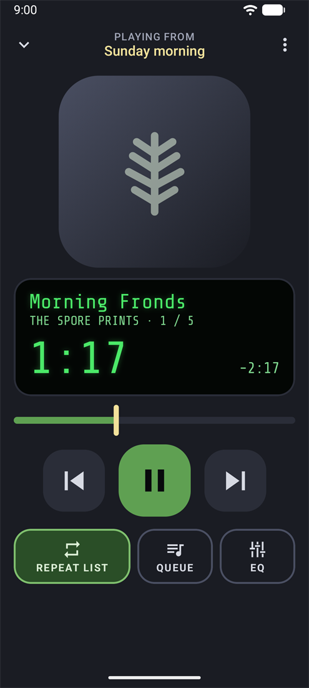

#  Fernplay for Android

A simple music player for Android: open it, pick a track or a playlist, play.

<p>
  
  
</p>

Fernplay plays the music already on your phone. You pick your music folders once and new songs appear by themselves. Playlists live inside the app, all on the home screen, never as files in folders. Repeat is always one tap away, on the player and in the notification, and the lock screen, headset, Bluetooth and car buttons all control playback.

The EQ is the one from Fernplay for Windows: ten bands from 60 Hz to 16 kHz, a preamp, the same built-in presets and your own, and a curve that shows what you hear. It sounds the same on every phone because Fernplay does the filtering itself instead of relying on the phone maker's equalizer.

It can also be the remote for Fernplay on your PC: pair once with a 6-digit code, then play, pause, skip, seek, set the volume, Shuffle, Repeat and Crossfade, and pick a track from the PC's playlist. Home network only, encrypted, and only with the PC you paired.

It is the Android sibling of [Fernplay](https://github.com/codekunde/Fernplay) for Windows and shares its look: a dark frame, a green LCD-style display and a fern.

**Status:** 0.3.0 adds the remote for Fernplay on your PC. Download `fernplay-0.3.0.apk` from the Releases page and open it on your phone (Android asks once to allow installs from that app); it installs over 0.2.0 and keeps your playlists.

## Requirements

Android 8.0 or later.

## Pairing with your PC

Phone and PC talk over TLS. When you pair, the phone remembers the PC's certificate and gets a key of its own, and every later connection proves both. One known limit: the 6-digit code is not protected by a password-authenticated key exchange (PAKE). Someone already intercepting traffic on your Wi-Fi during the two minutes the code is shown could work out the code and pair in place of your phone. They would get what the remote gets, control of Fernplay on that PC and a view of its playlist, and nothing else on the PC. Pair on a network you trust; you can remove a paired phone in the PC's Settings at any time.

## Building

JDK 17 and the Android SDK (platform 35).

```
./gradlew assembleDebug
./gradlew testDebugUnitTest
```

The debug APK is written to `app/build/outputs/apk/debug/`.

`./gradlew testDebugUnitTest` runs on the JVM, no device needed: Room and ExoPlayer run under Robolectric.

### Release build

`./gradlew assembleRelease` signs the APK when these Gradle properties are set, for example in `~/.gradle/gradle.properties` (never in the repo):

```
fernplay.storeFile=/path/to/release.jks
fernplay.storePassword=...
fernplay.keyAlias=...
fernplay.keyPassword=...
```

Without them the APK is written unsigned to `app/build/outputs/apk/release/`.

## Licence

MIT, see [LICENSE](LICENSE). The LCD font, Share Tech Mono, is under the SIL Open Font License 1.1, see [THIRD-PARTY-NOTICES.md](THIRD-PARTY-NOTICES.md).
